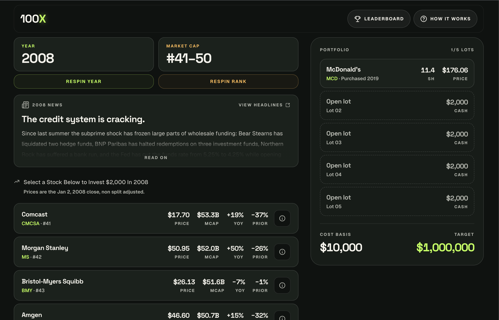
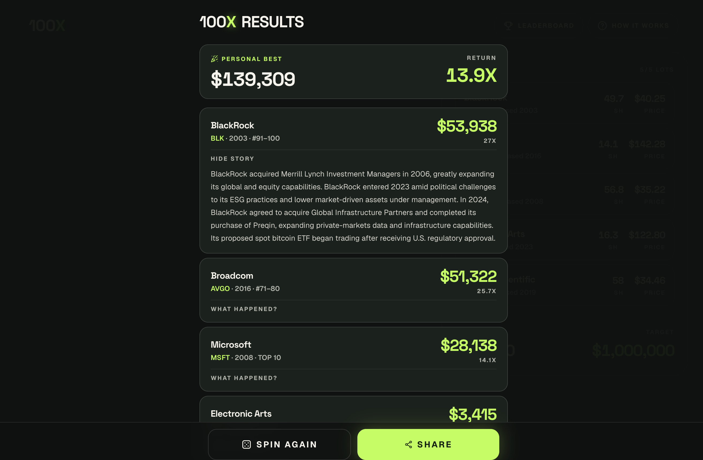

<div align="center">

# 100X

### Pick five stocks from the past. Turn $10K into $1M.

A fast, replayable historical stock-picking game. Spin a year, spin a market-cap rank,<br/>
pick one company using only what investors knew back then — and hold it until today.

<br/>

<a href="https://100x.chrisvillegas.com"></a>

<br/><br/>


<br/>

<a href="https://100x.chrisvillegas.com">
  
</a>

</div>

<br/>

## How to play

| | |
|:-:|:--|
| 🎰 | **Spin.** Land on a year and a market-cap band from that year's 100 largest U.S. companies. |
| 🔍 | **Pick.** Choose one of ten companies. You only see what an investor could have known then: price, market cap, recent returns, and that year's headlines. |
| 🔁 | **Repeat.** Make five picks at $2,000 each. You get one year respin and one rank respin per run. |
| 💰 | **Reveal.** Every pick is held until today. Returns stay hidden until all five are locked in. |
| 🏁 | **Hit 100X.** Grow $10,000 into **$1,000,000** and climb the leaderboard. |

A full run takes about two minutes.

<br/>

<div align="center">
  
  <br/>
  <sub><b>The reveal.</b> See what each pick became, read what happened to the company, and share your result.</sub>
</div>

<br/>

## Features

- **Historical boards.** Ten companies per market-cap band, drawn from each year's top 100 U.S. stocks.
- **Era context.** Headlines and a short brief for every year, written as of the entry date with no hindsight.
- **Real price history.** Entry prices are the actual closing print, and hold multiples are split-adjusted to today's close.
- **Company stories.** After the reveal, read what happened to each pick and see the best pick from every board you faced.
- **Leaderboards.** Anonymous daily, weekly, and all-time rankings.
- **Shareable results.** Every run gets a share link with a generated Open Graph card.
- **Mobile-first.** Built to feel quick on a phone and look sharp on desktop.

## Tech stack

| Layer | Technology |
|:--|:--|
| Framework | Next.js 16 (App Router) and React 19 |
| Language | TypeScript |
| Styling | Tailwind CSS 4 |
| Data | PostgreSQL for game sessions and leaderboards |
| Market data | Financial Modeling Prep and Yahoo Finance, cached to JSON |
| Hosting | Vercel |

## Running locally

```bash
git clone https://github.com/cdvillegas/100x.git
cd 100x
npm install
npm run dev
```

Then open [localhost:3000](http://localhost:3000).

To persist games and leaderboards, set `DATABASE_URL` (or `POSTGRES_URL`) to a Postgres connection string. The tables are created automatically on first use.

| Command | Description |
|:--|:--|
| `npm run dev` | Start the dev server |
| `npm run build` | Build for production |
| `npm test` | Run the unit tests |
| `npm run quotes` | Refresh the hold-to-today price snapshot |
| `npm run fundamentals` | Refresh the historical fundamentals snapshot |

## Data notes

Listed share prices are the actual close on the entry date and are not split-adjusted, so they match what you would have seen that day. Hold multiples adjust for splits from that session to the latest cached close. They count price only, with dividends not reinvested. Market caps and income-statement figures come from the last filing on or before the entry date.

<br/>

<div align="center">

**100X is a historical simulation for entertainment. It is not investment advice.**

<sub>Built by <a href="https://chrisvillegas.com">Chris Villegas</a></sub>

</div>
